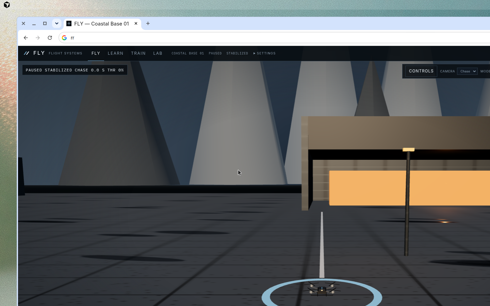

# FLY

Learn to fly. Teach machines to fly.

FLY is an open-source educational platform for civilian FPV flight simulation,
drone engineering, and autonomous landing experiments. It is not a weapon
system and it is not a navigation product.

The city view is a browser rigid-body simulator. The lab is a separate,
tested Python model of vertical motion. They are not the same integrator.



## What you can do

| Environment | What works |
| --- | --- |
| FLY | Fly EXPLORER-4, a 6-DOF quadcopter, at fictional Coastal Base 01. Preflight briefing, FPV, chase, and orbit cameras. WASD and arrow keys. Gamepad when the browser exposes one. Touch sticks on a coarse pointer. Free flight, a six-stage academy, and a precision landing scored from the touchdown. |
| LEARN | A hover lesson checked against the Python trace, and a pitch lesson checked against the rigid-body force equation. Other topics point at a real experiment or say they are not lessons yet. |
| TRAIN | Deterministic landing episodes on the marked roof. Position descent and vertical-only descent. Position error, touchdown speed, and a success count of episodes you actually run. |
| LAB | The Python 1D plant: mass, thrust, drag, and the named experiments. |

The coastal field is documented in [docs/COASTAL.md](docs/COASTAL.md). EXPLORER-4
is documented in [docs/AIRCRAFT.md](docs/AIRCRAFT.md). The train episode still
uses the Flatiron extract in [docs/DISTRICT.md](docs/DISTRICT.md). That extract
is approximate and not for navigation. Map data © OpenStreetMap contributors, ODbL.
No policy is trained. The instructor is not a language model.

## Models

The 6-DOF plant is documented in [docs/RIGID_BODY.md](docs/RIGID_BODY.md).
World axes are x east, y north, z up. Body thrust is along body z. The step is

```
m*a = R(q)*[0,0,T] + [0,0,-m*g] - c_d*|v|*v
I*alpha = tau - omega × (I*omega)
q_next = normalize(q ⊗ Exp(omega * dt))
p_next = p + v*dt + 0.5*a*dt*dt
```

The 1D plant is documented in [docs/MODEL.md](docs/MODEL.md). Units are in
[docs/UNITS.md](docs/UNITS.md). The shipped vertical case is a 1 kg vehicle
commanded to 2 m with a PID and gravity feedforward. That PID is classical
control, not artificial intelligence.

## Architecture

```
aerosim/physics       1D forces and RK4
aerosim/control       PID altitude law and constant thrust
aerosim/simulation    1D state, runner, experiments
aerosim/api           HTTP access to a run and the experiment catalog
frontend/src/sim      6-DOF rigid body, mixer, collision, landing, instructor
frontend/src/pages    FLY, LEARN, TRAIN, LAB
docs                  Model notes
```

Rendering, pilot input, the instructor, and the landing policy call the rigid
body. They do not invent a second set of flight numbers.

## Run the tests

```bash
python3 -m venv .venv
.venv/bin/pip install -e ".[dev]"
.venv/bin/pytest
```

```bash
cd frontend
npm install
npm run test:sim
```

## Run locally

The city flight and the landing episodes run in the browser without Python.
The lab and the hover lesson need the API.

Terminal A, for the lab and the hover lesson:

```bash
.venv/bin/python -m aerosim.api.server
```

Terminal B:

```bash
cd frontend
npm install
npm run dev
```

Open the URL Vite prints. The dev server proxies `/api` to
`http://127.0.0.1:8000`.

Print one 2 m hover without the interface:

```bash
.venv/bin/python -m aerosim
```

## Flight controls

W and S raise and lower collective thrust. A and D yaw. The arrow keys pitch
and roll. C switches FPV and chase. R resets. Space pauses. H shows the control
card. Esc opens the pause menu. Keys can be remapped from that card. Stabilized
mode levels roll and pitch when the arrow keys are centered. Throttle is
collective thrust, not an altitude hold. Acro mode commands body rates and does
not level the vehicle.

A gamepad, when the browser exposes one, uses the left stick, the right-stick
X axis, and the triggers. The dead zone is adjustable. Touch screens get two
virtual sticks: throttle with yaw, and pitch with roll.

## Deploy

Vercel can host the static frontend. `vercel.json` builds `frontend` and
publishes `frontend/dist`. FLY and TRAIN work on that host because the rigid
body runs in the browser.

The Python API is a separate process. Vercel does not run it. Host that
process on a machine that can stay up, and point the frontend at it only when
you have a real API origin. Until then, the lab and the hover lesson report
that the API is unavailable.

The public site is
[https://barneysmith-sys.github.io/fly/](https://barneysmith-sys.github.io/fly/).
GitHub Pages for this repository publishes the root of the branch. Jekyll
would turn this README into that site, so the root contains `.nojekyll` and
the production build: `index.html`, `404.html`, `favicon.svg`, and `assets/`.
Those files are the application. This README stays the repository
documentation. Asset URLs use the `/fly/` base path, and `404.html` is a copy
of `index.html` so a direct path still loads the simulator.

Refresh the published files after a frontend change:

```bash
cd frontend
GITHUB_PAGES=true npm run build
node scripts/sync-pages.mjs
```

`.github/workflows/pages.yml` builds the same frontend. That Actions artifact
is what the site uses after the repository Pages source is set to GitHub
Actions. The Python API is not part of the site, so the lab and the hover
lesson report that the API is unavailable there. FLY and TRAIN run in the
browser.

The repository homepage field is still unset. An anonymous
`vercel deploy --temporary` preview expires and is not a homepage.

## Roadmap

1. Motor lag and a documented sensor model, still separate from the truth state.
2. A scored manual landing in the same district.
3. One more city only after this district is solid.
4. A learning loop that writes real episode returns. Not before the
   deterministic landing controller is the baseline.

## Engineering principles

- Do not draw motion the integrator did not produce.
- Do not show a training curve, success rate, or model result that was not computed.
- Label approximate geography as fictional.
- Keep the 1D plant and the 6-DOF plant documented as different models.
- Say when a curriculum topic is not a lesson yet.

## Known limitations

- Coastal Base 01 is a fictional field. The bay is a solid surface, not a fluid. Mountain collision is a ridge volume, not a surveyed terrain mesh.
- The default flight aircraft is EXPLORER-4 only. Survey and research classes are not built.
- Contact is an inelastic sphere. There is no friction or landing-gear force. Motor lag is a first-order stand-in, not an electrical model.
- The Flatiron extract remains available to the train episode. Facades there are drawn, not surveyed.
- No motor dynamics, wind, sensor noise, or estimator.
- The attitude controller is proportional attitude and rate. It has no integral term.
- Landing success is a fixed set of limits on that episode, not a learned policy.
- The instructor answers five questions from the current state with fixed rules.
- Lesson progress for the hover module is stored in this browser only.
- No license has been chosen for this repository.

## Suggested GitHub topics

These match the repository as it is: `drone-simulator`, `fpv`, `quadcopter`,
`robotics`, `flight-dynamics`, `autonomous-systems`, `aerospace`,
`typescript`, `python`.

`reinforcement-learning` does not belong yet. Nothing in the repository
trains a policy.
